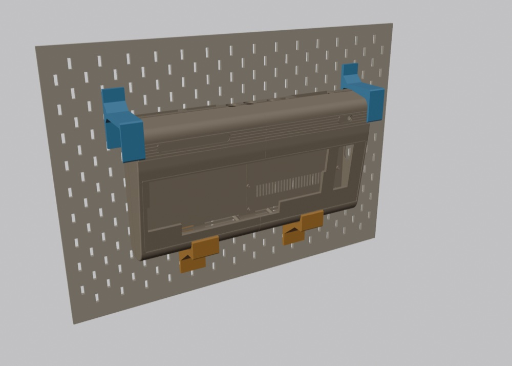
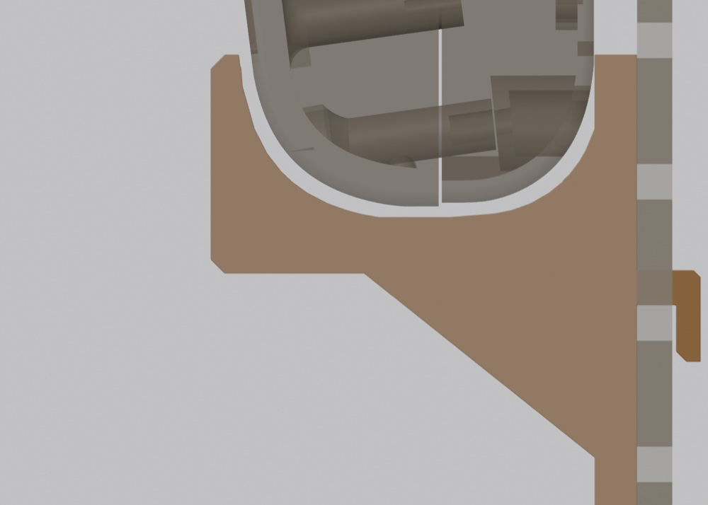
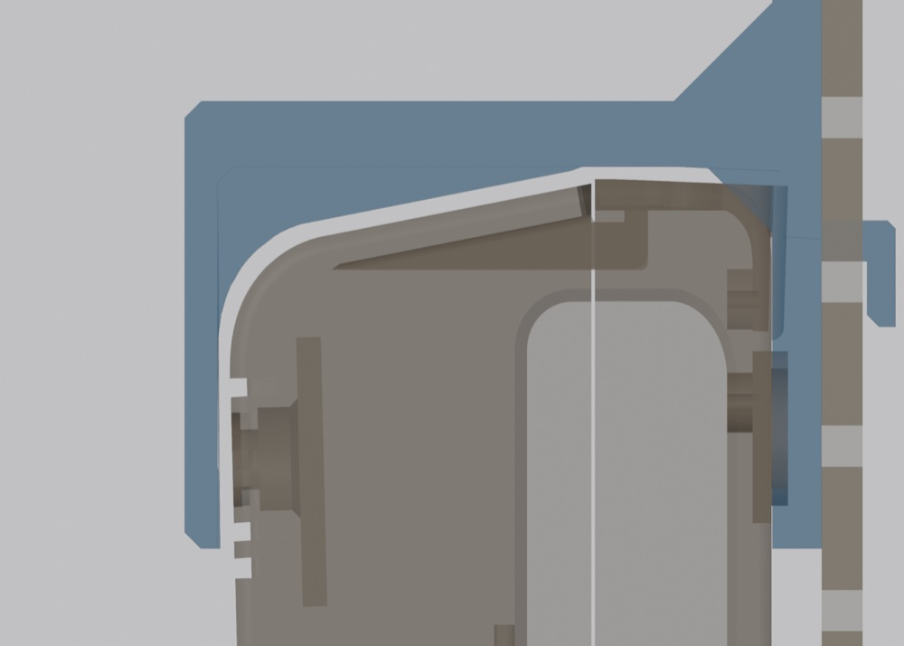
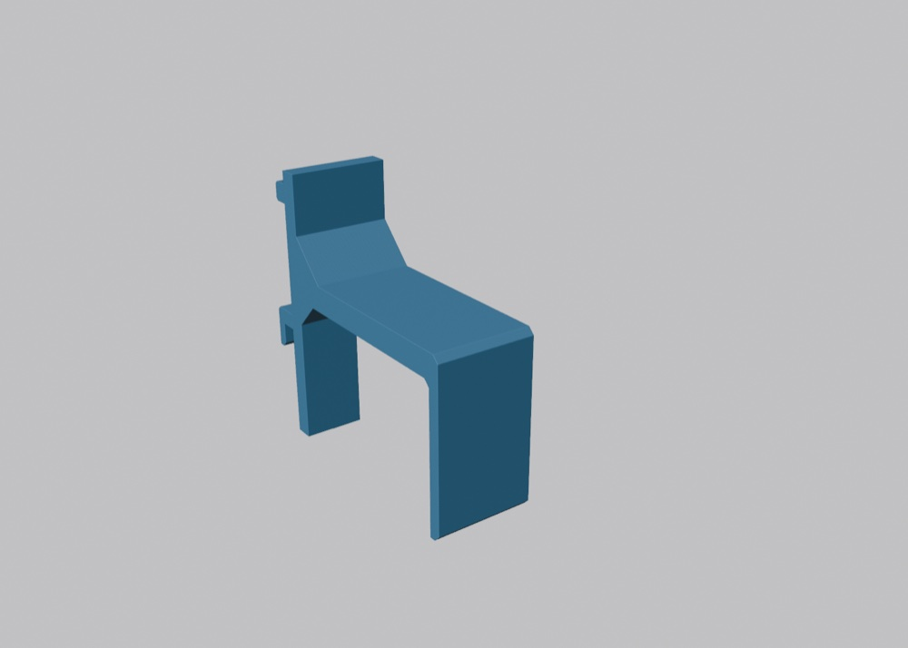
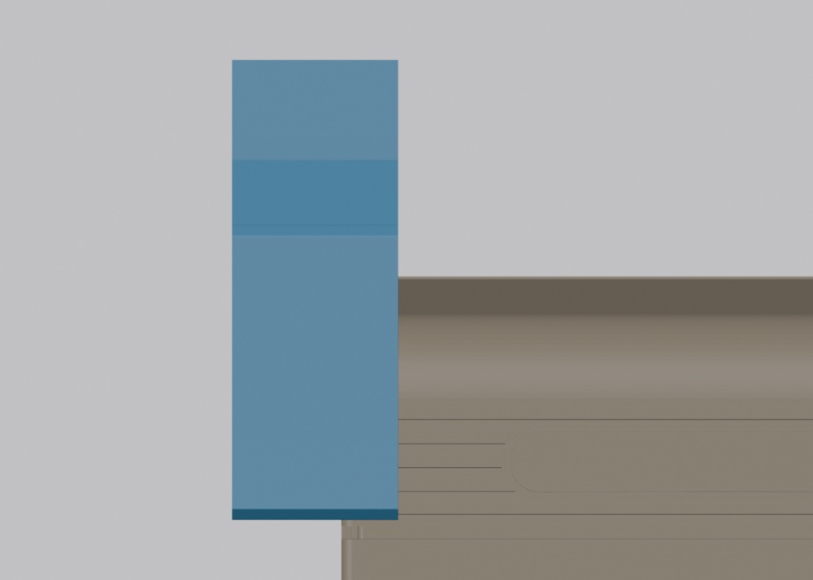
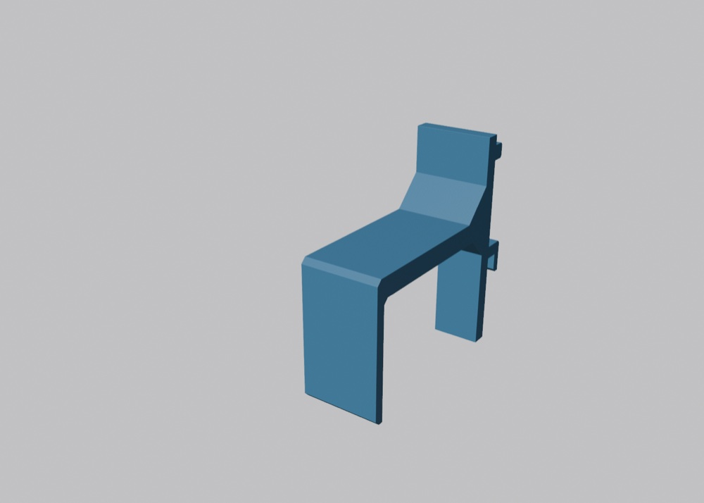
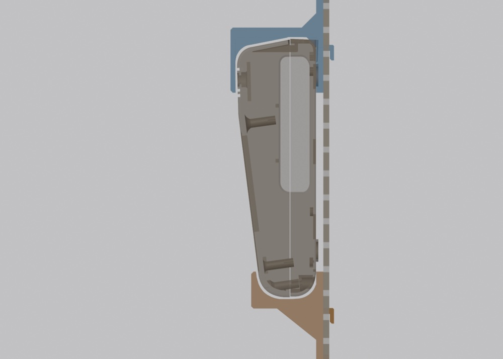
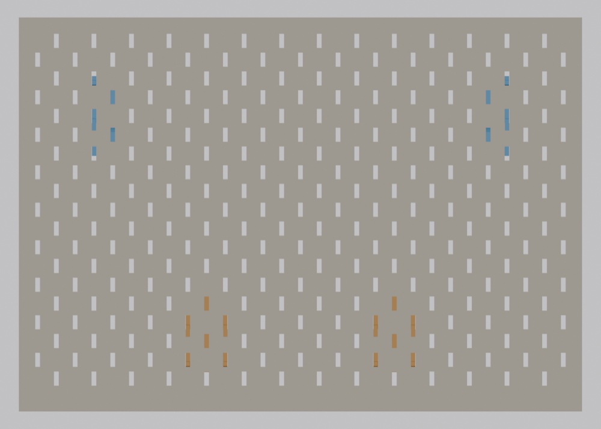
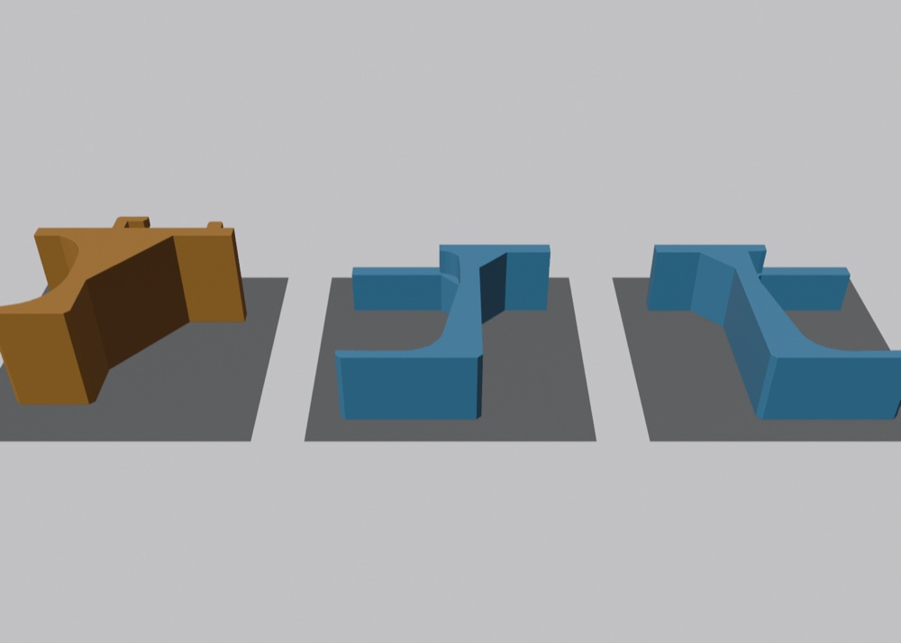

# Soportes IKEA Skadis para Commodore 64 (breadbin)

Soportes impresos en 3D para colgar una **Commodore 64 "breadbin" original** en un tablero perforado **IKEA Skadis**. La computadora queda **vertical**, con la base contra el tablero y el **teclado mirando al frente**, como pieza de exhibición. El borde delgado (barra espaciadora) va abajo y el borde grueso (puertos) va arriba, así que los cables salen hacia arriba.

Restricción principal: cada pieza debe caber en una impresora con cama de **110 × 110 × 110 mm**.



## Contenido

| Archivo | Qué es |
|---|---|
| `c64_skadis_mount.blend` | Archivo entregable de Blender 4.3.2. Colecciones: **Preview** (maqueta: tablero, C64 y soportes montados), **Print** (piezas ya orientadas para imprimir) y **BedRef** (cuadros de 110 mm para comparar con la cama). |
| `c64_skadis.py` | Script generador (bpy + bmesh + numpy). Construye todo el `.blend` a partir de parámetros. También va incrustado en el `.blend` como bloque de texto `c64_skadis.py`. |
| `ref_c64/` | **No incluido.** Carpeta donde el script busca los STL del modelo de referencia de la carcasa ([Commodore 64 case V 2.1 en MakerWorld](https://makerworld.com/en/models/1049608-commodore-64-case-v-2-1)). Ver [Regenerar el modelo](#regenerar-el-modelo). |
| `docs/renders/` | Imágenes de este documento. |
| `c64_skadis_mount-cradle.stl` | Cuna lista para imprimir ×2 (1370 triángulos, 81.0 × 69.3 × 44.4 mm). |
| `c64_skadis_mount-topclip_r.stl` | Retén superior derecho listo para imprimir ×1 (1204 triángulos, 85.0 × 86.6 × 30.7 mm). |
| `c64_skadis_mount-topclip_l.stl` | Retén superior izquierdo listo para imprimir ×1 (1164 triángulos, 85.0 × 86.5 × 30.7 mm). |

## Piezas

Hay 4 soportes y 3 diseños distintos:

| Pieza | Cantidad | Función | Tamaño de impresión |
|---|---|---|---|
| **Cradle** (cuna inferior) | ×2 (idénticas) | Carga el peso. Una copa conformada abraza la "nariz" delantera redondeada de la C64. | **81.0 × 69.3 × 44.4 mm** |
| **TopClip_R** (retén superior derecho) | ×1 | Evita que la C64 se vaya hacia adelante. Agarra 10.7 mm de la esquina superior derecha. | **85.0 × 86.6 × 30.7 mm** |
| **TopClip_L** (retén superior izquierdo) | ×1 | Espejo del derecho. Agarra la esquina izquierda en los 10.7 mm libres antes del user port. | **85.0 × 86.5 × 30.7 mm** |

Todas caben en la cama de 110 mm y son un solo sólido cerrado (0 aristas non-manifold). El script lo verifica en cada ejecución.

### Cuna (Cradle)

Tiene una placa trasera contra el tablero, una repisa con cartela triangular de refuerzo y una copa recortada con la forma real de la carcasa. Esta copa sube **23 mm** sobre el asiento y tiene un labio frontal de 4 mm. Abarca exactamente dos ranuras de la misma fila del Skadis (40 mm entre centros) y tiene dos juegos de ganchos.



### Retenes superiores (TopClip)

Cada retén cuelga de **una sola columna** del Skadis, en x = ±220 mm, justo fuera del ancho de la C64. Los dos retenes son simétricos y miden 30.7 mm de ancho, como en la primera versión del diseño.

- **Placa:** baja junto al costado de la C64. El gancho va en la fila 11 y la espiga en la fila 13.
- **Brazo:** pasa sobre el borde superior de la carcasa y lleva una cartela de refuerzo.
- **Labio:** baja **45 mm** por la cara del teclado.
- **Perfil:** el brazo y el labio conservan el perfil conformado de la carcasa del modelo actual, incluida la reducción de 4.5 mm en Y.
- **Agarre:** cada retén agarra la esquina en x = 191.5 … 202.2 mm, unos 10.7 mm. Del lado izquierdo, ese es el espacio libre antes del user port (x = −188.5 mm). Por fuera de la C64, la placa, el brazo y el labio forman un marco cerrado.
- **Impresión:** con un solo juego de ganchos, los dos quedan al ras de la cara que va sobre la cama, así que los retenes no necesitan soportes.



| Retén izquierdo (sin la C64) | Retén izquierdo, vista frontal | Retén derecho (sin la C64) |
|---|---|---|
|  |  |  |

### Corte lateral del montaje



## Dimensiones consideradas

### Commodore 64 breadbin

| Medida | Valor | Origen |
|---|---|---|
| Ancho (X) | **404 mm** | Medida real; el modelo de referencia ya mide 404 mm. |
| Profundidad (queda vertical, Z) | **216 mm** | Medida real. El modelo mide 206.3 mm y se estira ×1.047. |
| Alto/grosor (queda en Y, hacia el frente) | Perfil del modelo de referencia (máx. 70.6 mm sin patas) **menos 4.5 mm** | La carcasa real es más delgada que el modelo impreso. Ver `Y_REDUCE`. |
| Alto nominal | ~32 mm al frente, ~75 mm atrás (con patas) | Fichas técnicas (ver referencias). |
| Peso | ~1.8 kg | Fichas técnicas. |
| Teclas | empiezan a ~24 mm del borde delantero | Limita la altura del labio de la cuna. |
| Puertos traseros (x en mm, vistos de frente, 0 = centro) | Cassette/user port −188.5 … −116 y −100 … −52; −40 … −24; −8 … 4; 32 … 40; 56 … 64; cartucho 84 … 156.5 | Medidos sobre el modelo de referencia. |
| Pared trasera libre | −202 … −188.5 (izq.) y 157 … 202 (der.) | Ahí agarran los retenes. |

Medidas a verificar en tu C64 con calibrador antes de imprimir: ancho, profundidad, grosor máximo en la parte trasera, grosor a ~23 mm del borde delantero y posición del user port.

### IKEA Skadis

| Medida | Valor |
|---|---|
| Ranuras | 5 × 15 mm |
| Separación horizontal entre columnas | 40 mm |
| Separación vertical entre filas | 20 mm, filas alternas desplazadas 20 mm |
| Grosor del tablero | 5 mm |

### Ganchos (pegs)

- **Gancho superior:** tab de 4.4 mm (holgura en ranura de 5), cuello de 5 × 5.5 mm y un dedo de 3.5 mm que baja 8 mm detrás del tablero.
- **Espiga inferior:** recta, de 6 mm de alto. Evita el giro.
- **Instalación:** se inserta la pieza 8–9 mm más arriba y luego se deja caer.
- **Posiciones:**
  - Cunas: gancho en la fila 0 y espiga dos filas abajo. Cuna derecha en las columnas x = 80/120 mm; cuna izquierda en x = −120/−80 mm.
  - Retenes: una columna cada uno (x = ±220 mm), gancho en la fila 11 y espiga en la fila 13.



### Parámetros principales del script

| Parámetro | Valor | Significado |
|---|---|---|
| `C64_W`, `C64_D` | 404, 216 | Ancho y profundidad de la C64 |
| `CLR` | 1.5 | Holgura entre piezas y carcasa |
| `Y_REDUCE`, `Y_RAMP` | 4.5, 20 | Cuánto se adelgaza la carcasa del modelo (completo a partir de 20 mm de grosor, con una rampa suave cerca de la base) |
| `PLATE_T` | 6 | Grosor de las placas traseras |
| `TAB_W`, `NECK_H`, `FINGER_DROP`, `PIN_H` | 4.4, 5, 8, 6 | Geometría de los ganchos |
| `CR_XT`, `CR_COLS` | 80, 2 | Columna y número de columnas de la cuna |
| `CR_LIP_H`, `CR_LIP_T` | 23, 4 | Alto y grosor del labio de la cuna |
| `CL_R_COLS`, `CL_L_COLS` | (220,), (−220,) | Columna de cada retén |
| `CL_R_ARM`, `CL_L_ARM` | (191.5, 202.2), (−202.2, −191.5) | Rango en x del brazo/labio que agarra la carcasa |
| `CL_ARM_T`, `CL_LIP_T`, `CL_LIP_H` | 8, 4, 45 | Brazo y labio de los retenes |
| `BED` | 110 | Tamaño de la cama (verificación) |

## Exportar e imprimir



1. Abre `c64_skadis_mount.blend` y entra en la colección **Print**. Ahí están `PRINT_Cradle_x2`, `PRINT_TopClip_R` y `PRINT_TopClip_L`, ya orientados.
2. Selecciona **una** pieza y usa *File → Export → STL* con **Selection Only** activado. Repite para cada pieza. Imprime la cuna dos veces.
3. **Orientación:** cada pieza se imprime de canto, apoyada sobre la cara donde el primer juego de ganchos queda al ras. Así las capas corren a lo largo del gancho y la carga no las separa.
4. **Soportes:** en la cuna, el segundo juego de ganchos queda en el aire y necesita soportes desde la cama. Los retenes no necesitan soportes.
5. Sugerido: PETG o PLA, 4 perímetros y 30–40 % de relleno. La C64 pesa ~1.8 kg y casi todo lo cargan las cunas.
6. **Montaje:** cuelga primero las dos cunas y apoya la C64 en ellas. Después engancha los retenes desde arriba: se insertan 9 mm más arriba y caen sobre el borde superior.

## Regenerar el modelo

```bash
/Applications/Blender.app/Contents/MacOS/Blender -b -P c64_skadis.py -- c64_skadis_mount.blend [carpeta_renders]
```

El modelo de referencia de la carcasa no se incluye en este repositorio. Para regenerar:

1. Descarga [Commodore 64 case V 2.1](https://makerworld.com/en/models/1049608-commodore-64-case-v-2-1) desde MakerWorld.
2. Extrae los STL ensamblados de la carcasa (`commodore case 2.0 bottom left/right.stl` y `top left/right.stl`) en una carpeta `ref_c64/` junto a `c64_skadis.py`. Solo deben quedar esos STL en la carpeta, porque el script carga todos los `*.stl` que encuentre.
3. Si prefieres otra ubicación, define `C64_REF_DIR=/ruta/a/los/stl` antes de ejecutar Blender.

El script carga esos STL, construye las piezas, verifica que cada una sea manifold y quepa en la cama, guarda el `.blend` y, si se le da una carpeta, renderiza las vistas 01–05. **Cierra Blender antes de regenerar:** si el archivo sigue abierto, Blender puede sobrescribir la versión nueva al guardar.

## Referencias

- Modelo de referencia de la carcasa: [Commodore 64 case V 2.1 en MakerWorld](https://makerworld.com/en/models/1049608-commodore-64-case-v-2-1), remezclado por Ege Özpalamutcu (@Ege_Özpalamutcu), CC BY-NC 4.0. Se basa en [Commodore 64 de biscottone en Thingiverse](https://www.thingiverse.com/thing:3474432) (CC BY-NC 4.0). Es una réplica imprimible de la carcasa breadbin, en STL ensamblados de 404 × 206.3 mm. Se usa solo como forma de referencia para las curvas.
- Ficha técnica de la Commodore 64 (dimensiones y peso): [rigpix.com — Commodore 64](https://rigpix.com/vcomp/commodore_64.htm)
- [Commodore 64 en Wikipedia](https://en.wikipedia.org/wiki/Commodore_64)
- Otras réplicas de carcasa consultadas para comparar formas: [Modular Commodore case (Printables)](https://www.printables.com/model/933610-modular-commodore-case), [Breadbin Commodore 64 enclosure (CGTrader)](https://www.cgtrader.com/3d-print-models/hobby-diy/electronics/breadbin-commodore-64-enclosure-3d-print-model)
- Sistema IKEA Skadis: ranuras de 5 × 15 mm en retícula de 40 × 20 mm escalonada, tablero de 5 mm.
- [Blender 4.3](https://www.blender.org/) (Python API `bpy`, `bmesh`)

## Licencia y atribución

Este proyecto se distribuye bajo [Creative Commons Atribución-NoComercial 4.0 Internacional (CC BY-NC 4.0)](https://creativecommons.org/licenses/by-nc/4.0/). Ver [`LICENSE`](LICENSE). Puedes compartirlo y modificarlo dando crédito, pero no usarlo con fines comerciales.

Parte del proyecto se deriva de **"Commodore 64 case V 2.1"**, remezclado por **Ege Özpalamutcu** ([@Ege_Özpalamutcu](https://makerworld.com/en/models/1049608-commodore-64-case-v-2-1)) y publicado en [MakerWorld](https://makerworld.com/en/models/1049608-commodore-64-case-v-2-1) bajo [CC BY-NC 4.0](https://creativecommons.org/licenses/by-nc/4.0/). A su vez, es una remezcla de **"Commodore 64"** de **biscottone**, publicado en [Thingiverse](https://www.thingiverse.com/thing:3474432) bajo [CC BY-NC 4.0](https://creativecommons.org/licenses/by-nc/4.0/). Ninguno de los dos modelos se incluye en el repositorio.

Cambios respecto al original: la geometría se escaló a 404 × 216 mm y se adelgazó en el eje Y (`Y_REDUCE`). Se usa para la maqueta de la C64 en la colección Preview y en los renders, y para calcular el perfil de las copas de la cuna y de los retenes.

## Cómo se crearon los soportes (resumen del proceso)

1. **Planeación.** Se definió el modelo (C64 breadbin original), la orientación (vertical, teclado al frente, puertos arriba) y el entregable (`.blend`). El primer diseño tenía 2 cunas y 2 retenes con placa trasera, un gancho Skadis y una espiga, todo parametrizado en un script de Blender ejecutado en modo background. Unidades en mm.
2. **Primera versión con caja simplificada.** La C64 se modeló como una cuña (32 mm al frente, 75 mm atrás). Las piezas se construyeron con perfiles extruidos y booleanos (solver Exact) más bevel. Cada pieza se verifica como manifold y ≤ 110 mm. Las copias de impresión se movieron 400 mm abajo para no encimarse con la maqueta.
3. **Corrección de los retenes.** Estaban mal ubicados. Se recalculó su altura para que el labio cayera exactamente sobre el borde superior y los ganchos en filas válidas del Skadis.
4. **Medidas a verificar.** Se listaron las dimensiones de la C64 que había que confirmar. El usuario confirmó que eran correctas.
5. **Piezas más anchas y estables.** Cunas y retenes se ampliaron a 2 columnas del Skadis, con un segundo juego de ganchos.
6. **Forma real de la carcasa.** La breadbin es muy redondeada abajo y la cuña no la sostenía bien. Se descargó el modelo de MakerWorld y se cargó en el script, escalado a 404 × 216 mm. Con numpy se calcula la envolvente de grosor por altura (secciones de triángulos cada 0.5 mm, dilatada 1.5 mm). De ahí salen dos cortadores:
   - **Cuna:** la unión acumulada de abajo hacia arriba, para que la C64 pueda bajar y asentarse en ella. El resultado es una copa en U conformada a la nariz delantera.
   - **Retenes:** el volumen que barre la carcasa mientras el retén se acerca 9 mm más arriba y cae. Así se garantiza que se pueda instalar.

   Para que los booleanos no fallaran hubo que simplificar perfiles (eliminar astillas de < 0.2 mm) y no triangular las tapas de los prismas.
7. **Ajuste de anchos y retenes.** Las cunas se redujeron para abarcar solo dos ranuras de una misma fila. Los retenes se recortaron, se movieron hacia el centro y su labio se alargó hacia abajo (45 mm). Se mapearon los puertos traseros del modelo para que los retenes agarren solo en pared libre: 42 mm a la derecha y 10.5 mm a la izquierda, antes del user port.
8. **Retén izquierdo rehecho.** Tenía un brazo de 10.5 mm en voladizo desde una placa corrida hacia el centro. La placa se movió hacia afuera (columnas −240/−200) y, fuera de la C64, el brazo y el labio forman un marco a todo el ancho de la pieza.
9. **Profundidad −4.5 mm.** La carcasa real es más delgada que el modelo. Se añadió `Y_REDUCE = 4.5`, que adelgaza la carcasa de referencia con una rampa suave cerca de la base. Cunas y retenes quedaron 4.5 mm menos profundos y siguen conformados a la curva.
10. **Copa de la cuna más alta.** El labio de la cuna subió de 18 a 23 mm para mayor seguridad. La pieza quedó en 81 × 69.3 × 44.4 mm.
11. **Retenes angostos otra vez.** Los retenes de dos columnas resultaron demasiado anchos. Se volvió al ancho de la primera versión: una sola columna en x = ±220 mm, piezas de 30.7 mm, simétricas. Se conservó el perfil conformado de la carcasa actual. Como la columna queda fuera del ancho de la C64, la placa baja junto al costado (gancho en la fila 11), lo que también redujo la altura de 105 a 85 mm.

En cada iteración se regeneró el `.blend` y se comprobaron medidas, manifold y renders (vista general, cortes laterales, detalles, vista trasera de ganchos) antes de abrirlo en Blender para revisión.
